# 🎬 Muse2API Video Studio (`muse2api-video-studio`)

> **OpenAI-Compatible AI Video & Animation Studio Server powered by Muse AI**  
> Features **10s Single-Scene & 60s Multi-Scene (`1920x1080` Full HD) Video Generation**, **Zero-Cookie TinyHost OTP Auto-Login**, **100% Character & Snapshot Continuity (`master_keyframe` + `resume_from_snapshot_id`)**, and **Studio-Grade Multi-Character Voice Synchronization (`HTDemucs` + `Seed-VC 44.1kHz RMVPE + CAMPPlus + BigVGAN`)**.

---

## 🌟 Key Capabilities

| Feature | Description |
| :--- | :--- |
| **🗣️ 10s Talking-Animal & Comedy Skits** | Generate `1920x1080` Full HD 3D Pixar/Zootopia/TUBAn-style talking animal & insect skits with frame-accurate single-speaker lip-sync and expressive non-speaking character reactions. |
| **🎞️ 60s Multi-Scene Storyboard Engine** | Automatically generates a `master_keyframe.png` anchor image and chains up to **6 x 10-second scenes (`60s`)** via `resume_from_snapshot_id` for 100% visual continuity. |
| **🎙️ Neural Voice Synchronization (`44.1 kHz`)** | Eliminates random per-scene voice drift using **HTDemucs** vocal separation + **Seed-VC 44.1kHz (`RMVPE` F0-Conditioned + `CAMPPlus` + `BigVGAN`)** + **Cepstral Formant Envelope Matching**. |
| **🔐 Zero-Cookie TinyHost OTP Auto-Login** | Pass `"email@domain | https://tinyhost.shop/email@domain"` to `POST /admin/accounts/login` — the headless Chromium CDP driver logs in, fetches the 6-digit OTP automatically, and rotates session cookies. |
| **🖥️ Lanczos + CAS `1920x1080` Upscaling** | Built-in FFmpeg mastering pipeline (`lanczos + accurate_rnd + full_chroma_int + cas=0.7 + unsharp`, `H.264 CRF 17`, `24fps`). |

---

## 🎥 Live Video Demo Gallery (Embedded Previews + MP4 Downloads)

### Part A — 10-Second Talking-Animal & Slapstick Comedy Skits (`10s`)

#### 1. 🐛💨 Larva Sewer Worms Skit #1 — *The Green Aroma Cloud Attack* (`10s`)
* **▶️ Watch / Download MP4 Video (with Audio):** [**`docs/demos/demo_1_larva_fart_attack_10s.mp4`**](docs/demos/demo_1_larva_fart_attack_10s.mp4)

| Animated Preview (GIF) | High-Res Frame |
| :---: | :---: |
| 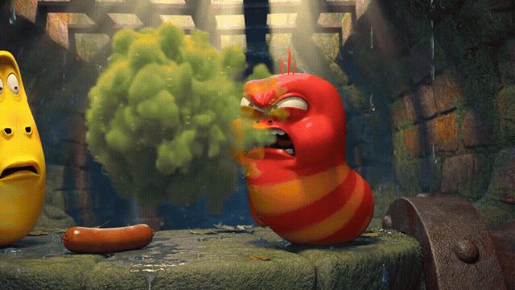 | 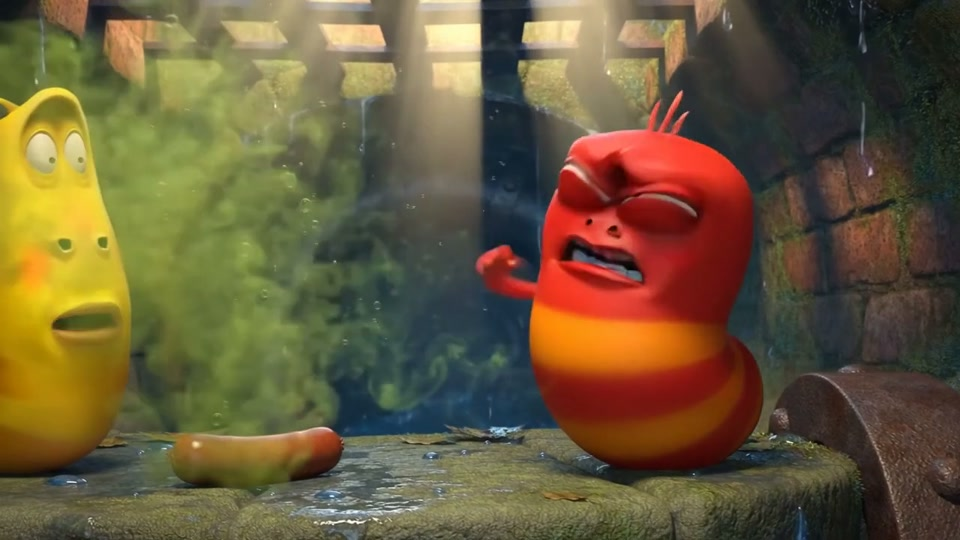 |

---

#### 2. 🐛🧄 Larva Sewer Worms Skit #2 — *Garlic Breath Dizzy Stars Counterattack* (`10s`)
* **▶️ Watch / Download MP4 Video (with Audio):** [**`docs/demos/demo_2_larva_garlic_breath_10s.mp4`**](docs/demos/demo_2_larva_garlic_breath_10s.mp4)

| Animated Preview (GIF) | High-Res Frame |
| :---: | :---: |
| 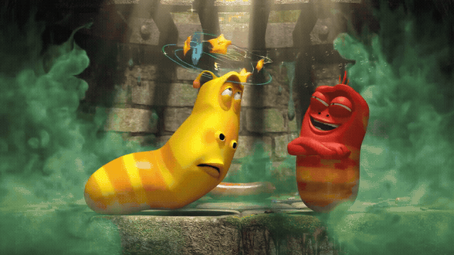 | 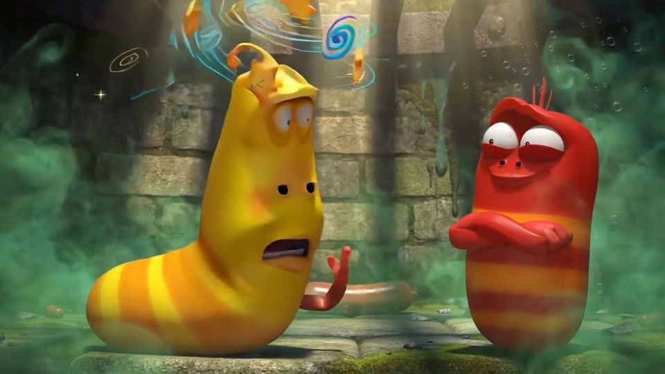 |

---

#### 3. 🐐🎒 Bipedal Student Goats Skit — *Late for School on the Narrow Bridge* (`10s`)
* **▶️ Watch / Download MP4 Video (with Audio):** [**`docs/demos/demo_3_student_goats_bridge_10s.mp4`**](docs/demos/demo_3_student_goats_bridge_10s.mp4)

| Animated Preview (GIF) | High-Res Frame |
| :---: | :---: |
|  | 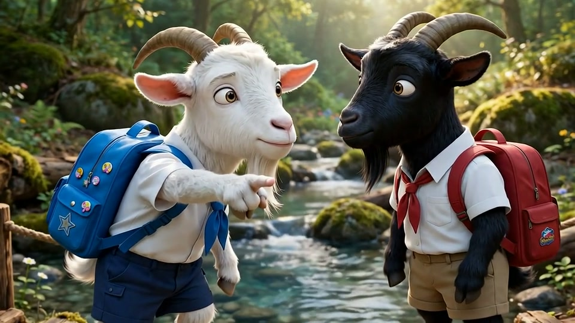 |

---

#### 4. 🐐🌲 Talking Animals Face-Off — *White Goat & Black Goat on the Log Bridge* (`10s`)
* **▶️ Watch / Download MP4 Video (with Audio):** [**`docs/demos/demo_4_talking_goats_skit_10s.mp4`**](docs/demos/demo_4_talking_goats_skit_10s.mp4)

| Animated Preview (GIF) | High-Res Frame |
| :---: | :---: |
|  | 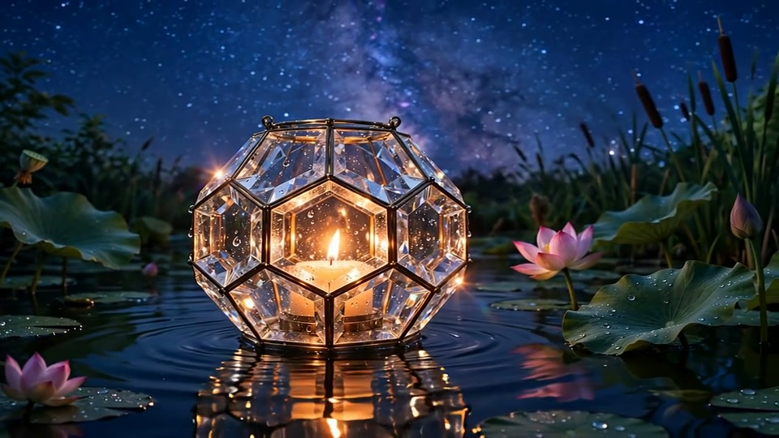 |

---

### Part B — Full 60-Second (`6 Scenes x 10s`) Multi-Scene Series with `Seed-VC 44.1kHz` Voice Sync

#### 5. 🐛💨 Full 60s Series: *Larva Sewer Worms Comedy — Fart vs. Stinky Breath* (`60s`, Voice-Locked)
* **▶️ Watch / Download Full 60s MP4 (with `Seed-VC 44.1kHz` Synchronized Voices):** [**`docs/demos/showcase_larva_sewer_worms_60s.mp4`**](docs/demos/showcase_larva_sewer_worms_60s.mp4)
* **Acoustic F0 Synchronization (`Seed-VC 44.1kHz + RMVPE + BigVGAN`):**
  * **Yellow Worm (Left — Scenes 1, 3, 5):** `F0_median = 225.5 Hz / 236.2 Hz / 222.5 Hz`
  * **Red Worm (Right — Scenes 2, 4, 6):** `F0_median = 244.1 Hz / 243.0 Hz / 244.6 Hz` (`±0.8 Hz` precision across all 3 scenes!)

| Animated Preview (GIF) | 6-Scene Continuity Storyboard (`0s–60s`) |
| :---: | :---: |
| 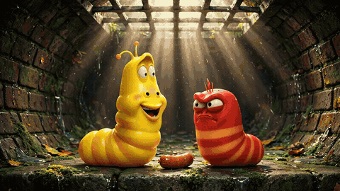 | 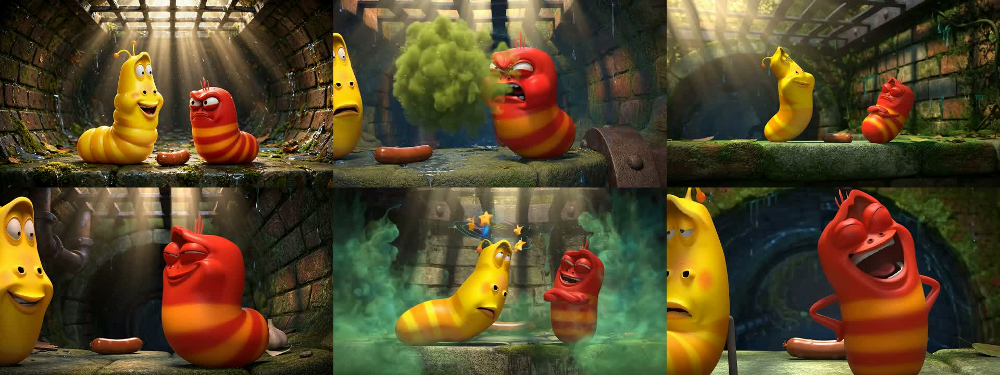 |

---

#### 6. 🐐🎒 Full 60s Series: *Two Bipedal Student Goats on the Narrow Bridge* (`60s`, Voice-Locked)
* **▶️ Watch / Download Full 60s MP4 (with `Seed-VC 44.1kHz` Synchronized Voices):** [**`docs/demos/showcase_student_goats_60s.mp4`**](docs/demos/showcase_student_goats_60s.mp4)
* **Acoustic F0 Synchronization (`Seed-VC 44.1kHz + RMVPE + BigVGAN`):**
  * **White Student Goat (Left — Scenes 1, 3, 5):** `F0_median = 267.3 Hz / 261.9 Hz / 269.8 Hz`
  * **Black Student Goat (Right — Scenes 2, 4, 6):** `F0_median = 182.8 Hz / 181.7 Hz / 179.6 Hz`

| Animated Preview (GIF) | 6-Scene Continuity Storyboard (`0s–60s`) |
| :---: | :---: |
| 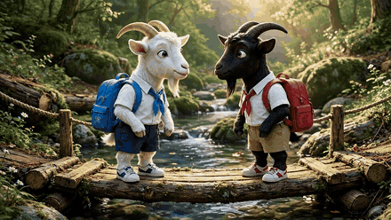 | 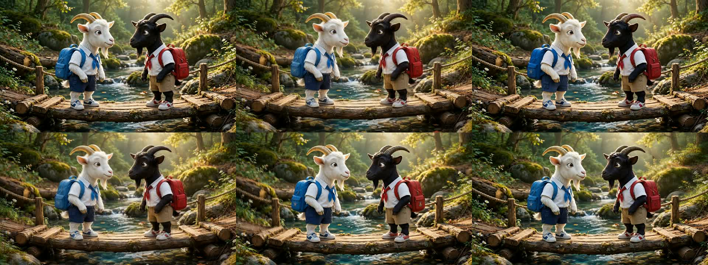 |

---

## 🎭 Ready-to-Run 10s English Talking-Animal Comedy Skit Prompts (`scripts/gen_english_skit_demos.py`)

Run all 3 English talking-animal comedy skits with one command via [`scripts/gen_english_skit_demos.py`](scripts/gen_english_skit_demos.py):

```bash
python scripts/gen_english_skit_demos.py
```

### Preset 1: 🐱🐶 *The Birthday Cake Interrogation* (Detective Cat & Guilty Golden Retriever)
```json
{
  "model": "muse-video",
  "size": "16:9",
  "duration": 10,
  "prompt": "3D Pixar and Zootopia style animated comedy skit, 16:9 widescreen, 8K cinema clarity. In a bright modern kitchen beside a half-eaten strawberry birthday cake, a chubby British Shorthair detective cat wearing a tiny plaid deerstalker hat and round glasses stands on the counter pointing a magnifying glass at a guilty Golden Retriever sitting below with pink frosting smeared all over his nose. ONLY the detective cat opens and moves his mouth, speaking in a dramatic, witty British male detective voice: \"Look me in the eyes, Barnaby! You expect me to believe the birthday cake jumped off the table and attacked your nose?!\" while the Golden Retriever keeps his mouth completely closed, wagging his tail nervously with wide guilty puppy eyes."
}
```

### Preset 2: 🐹🐻 *Personal Trainer Hamster & The Grizzly Bear*
```json
{
  "model": "muse-video",
  "size": "16:9",
  "duration": 10,
  "prompt": "3D Pixar and Zootopia style animated comedy skit, 16:9 widescreen, 8K cinema clarity. Inside a sunny modern fitness gym, a tiny chubby golden hamster wearing a miniature red sweatband and sport tank top stands on a bench pointing enthusiastically at a giant exhausted Grizzly Bear who is sweating heavily while struggling to curl tiny two-pound pink dumbbells. ONLY the tiny hamster opens and moves his mouth, yelling in a hilarious high-energy American gym coach voice: \"Come on Big Bruno, don't quit on me now! Those two-pound pink dumbbells aren't gonna lift themselves, lightweight baby!\" while the giant Grizzly Bear keeps his mouth closed, huffing and rolling his eyes in comic exhaustion."
}
```

### Preset 3: 🐧🐸 *Late-Night Animal Gossip Podcast* (Emperor Penguin & Sassy Tree Frog)
```json
{
  "model": "muse-video",
  "size": "16:9",
  "duration": 10,
  "prompt": "3D Pixar and Sing style animated comedy skit, 16:9 widescreen, 8K cinema clarity. Inside a trendy neon-lit podcast studio with professional broadcast microphones on boom arms, on the left sits a dapper Emperor Penguin wearing a red bowtie and headphones who keeps his beak completely closed and nods in shocked amazement; on the right sits a sassy bright-green Tree Frog wearing studio headphones who gestures dramatically with her webbed hands while speaking into the mic in a sassy, expressive American female comedy voice: \"And I told her, honey, if that toad is still hopping into other lily pads at midnight, he is definitely not your prince!\""
}
```

---

## 🏗️ System Architecture

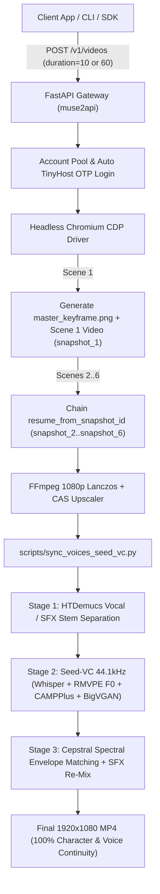

---

## 🚀 Quick Start & Software Integration

### 1. Installation & Startup

```bash
git clone https://github.com/ducanh3005/muse2api-video-studio.git
cd muse2api-video-studio

uv venv .venv --python 3.12
uv pip install --python .venv/bin/python -e .

cp .env.example .env
.venv/bin/python -m muse2api
```

### 2. Zero-Cookie Auto-Login (`POST /admin/accounts/login`)

```bash
curl -X POST http://127.0.0.1:18610/admin/accounts/login \
  -H "Authorization: Bearer sk-muse-local" \
  -H "Content-Type: application/json" \
  -d '{
    "account": "your_account@ccpro.click | https://tinyhost.shop/your_account@ccpro.click",
    "label": "studio-worker-1"
  }'
```

### 3. Multi-Scene Neural Voice Synchronization (`Seed-VC 44.1kHz`)

```bash
python scripts/sync_voices_seed_vc.py \
  --input data/media/vid_raw_60s.mp4 \
  --output data/media/vid_synced_60s.mp4 \
  --work-dir ./work_audio \
  --seed-vc-dir ./seed-vc \
  --v1-ref-scene 1 \
  --v2-ref-scene 2 \
  --v1-semitones 0.0 \
  --v2-semitones -2.0
```

---

## 📚 Documentation Index

- [**Developer Guide & Software Integration Manual (`docs/DEVELOPER_GUIDE.md`)**](docs/DEVELOPER_GUIDE.md)
- [**Architecture & Internals (`docs/ARCHITECTURE.md`)**](docs/ARCHITECTURE.md)
- [**10s English Talking-Animal Skit Batch Script (`scripts/gen_english_skit_demos.py`)**](scripts/gen_english_skit_demos.py)
- [**44.1kHz Neural Voice Synchronization CLI (`scripts/sync_voices_seed_vc.py`)**](scripts/sync_voices_seed_vc.py)

---

## 📄 License

MIT License
