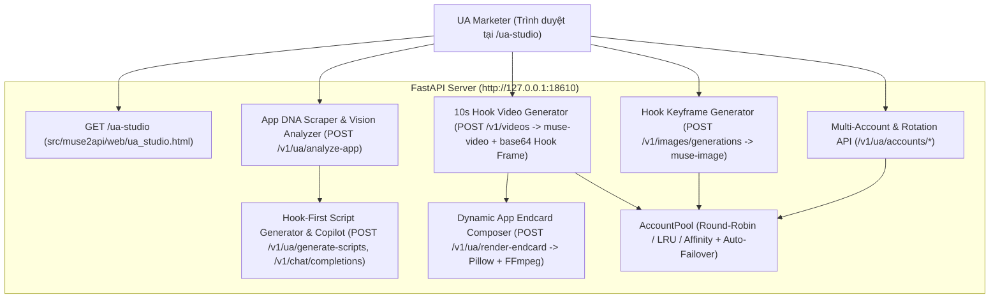

# Thiết Kế Hệ Thống: Muse UA Marketing Video Studio (`/ua-studio`)

- **Ngày tạo:** 2026-11-03
- **Dự án:** `muse2api-video-studio` (`http://127.0.0.1:18610/v1`, API Key mặc định `sk-muse-local`)
- **Mục tiêu:** Xây dựng Web Tool chuyên dụng cho **Mobile UA Marketing** tích hợp trực tiếp trong `muse2api`, cho phép người dùng chỉ cần truyền **Link App (Google Play / App Store)** hoặc **Ảnh chụp màn hình App** để phân tích sản phẩm, sinh hàng loạt kịch bản quảng cáo tập trung tối đa vào **3-Second Thumbstop Hook** (Drama, IQ 99% Fail, Giải cứu, Satisfying, POV, Pixar Talking Animals), tạo ảnh Hook Keyframe (`muse-image`), tạo Video Hook 10s (`muse-video` `1920x1080`) và tự động ghép **Dynamic App Endcard (`3.5s`)** bằng FFmpeg, kèm trình quản lý & xoay vòng **Multi-Account đa định dạng**.

---

## 1. Kiến Trúc Tổng Thể (Architecture)

Hệ thống được tích hợp trực tiếp vào ứng dụng FastAPI hiện có của `muse2api` để tận dụng toàn bộ `AccountPool`, `Gateway` (chế độ Headless Noise Gateway RPC API `MUSE2API_DRIVER=http`), `MediaStore`, và `TaskManager`:



### Các Module mới & Cập nhật:
1. **`src/muse2api/api/routes/ua.py` (Mới):**
   - Chứa toàn bộ REST API phục vụ UA Studio (`/v1/ua/*`) sử dụng xác thực `require_api_key` (hỗ trợ sẵn `sk-muse-local`).
2. **`src/muse2api/core/ua_endcard.py` (Mới):**
   - Module xử lý cào dữ liệu App Store / Google Play (`scrape_store_metadata`), dựng giao diện **App Endcard `1920x1080`** bằng `Pillow` (`PIL`) và ghép nối mượt mà với video 10s của `muse-video` bằng `FFmpeg` (`compose_ua_video_with_endcard`).
3. **`src/muse2api/web/ua_studio.html` & `src/muse2api/api/routes/pages.py` (Mới + Cập nhật):**
   - Giao diện Web Studio tại `GET /ua-studio` (và liên kết nhanh từ trang chủ/dashboard).

---

## 2. Chi Tiết Các Thành Phần (Components & Data Flow)

### 2.1. Smart Multi-Account Pool & Rotation Manager (`/v1/ua/accounts/*`)
Giải quyết bài toán nạp nhanh nhiều tài khoản Muse AI theo nhiều định dạng và xoay tua chịu tải khi tạo nhiều kịch bản/video cùng lúc:

- **`GET /v1/ua/accounts/pool`**:
  - Trả về danh sách tài khoản hiện có trong `svc.pool`, thống kê (`total`, `available`, `inflight`, `cooling`, `invalid`), chiến thuật xoay vòng hiện tại (`round_robin`, `lru`, `affinity`), và `max_concurrency`.
- **`POST /v1/ua/accounts/pool-config`**:
  - Cho phép đổi nóng chiến thuật xoay vòng (`strategy`: `"round_robin"` | `"lru"` | `"affinity"`) ngay trong runtime mà không cần khởi động lại server.
- **`POST /v1/ua/accounts/batch-import`**:
  - Nhận đầu vào `raw_text` (nhiều dòng hoặc mảng JSON) từ ô **Smart Multi-Account Box** và tự động phân loại 5 định dạng trên từng mục:
    1. **Bearer Token / Session Token trần (`Bearer <token>`, `hatch_sess=<token>`, hoặc chuỗi token dài không chứa `@`):**
       - Gán vào cookie `{"hatch_sess": token}`, gọi `muse.renew_session(cookies, wake_vm=True)` để lấy trọn bộ cookie phiên + đánh thức VM (`vm_id`), lưu vào `AccountPool`.
    2. **Chuỗi Cookie Header (`hatch_sess=...; cf_clearance=...` hoặc `ten_acc | hatch_sess=...`):**
       - Bóc tách toàn bộ cặp `key=value`, gọi `muse.renew_session` kiểm tra và lưu vào `AccountPool`.
    3. **Lệnh `cURL` (Copy as cURL từ Chrome DevTools):**
       - Trích xuất `-H 'Cookie: ...'` hoặc `-b '...'` hoặc `-H 'Authorization: Bearer ...'` và nạp vào `AccountPool`.
    4. **JSON Cookie Array / Object (Export từ Cookie-Editor / EditThisCookie):**
       - Đọc các phần tử `{"name": "...", "value": "...", "expirationDate": ...}` để tạo tài khoản.
    5. **Email + TinyHost / Generator.email Auto-OTP (`email@domain | https://tinyhost.shop/email@domain` hoặc `email@domain`):**
       - Gọi `svc.driver.login_with_email(email, mail_url)` để tự động lấy mã OTP 6 số và đăng nhập.
  - Tự động **chống trùng lặp (Deduplicate)**: Nếu trùng `email` hoặc trùng `hatch_sess` với tài khoản đã có, hệ thống cập nhật và kích hoạt lại (`AccountStatus.ACTIVE`) thay vì tạo bản ghi rác.
- **`POST /v1/ua/accounts/{account_id}/action`**:
  - Hỗ trợ `reset` (xóa cooldown/lỗi), `renew` (gia hạn phiên + wake VM), `toggle` (bật/tắt), `delete` (xóa khỏi pool) ngay trên giao diện `/ua-studio`.

---

### 2.2. App DNA Analyzer (`POST /v1/ua/analyze-app`)
Người dùng chỉ cần truyền **Link App (`store_url`)** hoặc **Ảnh chụp màn hình App (`screenshots`: danh sách data URL / base64)** (hoặc cả hai):

1. **Bước 1 — Trích xuất Metadata từ Store URL (nếu có `store_url`):**
   - **Apple App Store (`apps.apple.com`):** Trích xuất `appId` (VD: `id123456789`) và gọi iTunes Lookup API (`https://itunes.apple.com/lookup?id=...`) kết hợp đọc OpenGraph/HTML để lấy chính xác: `app_name`, `icon_url` (512x512), `rating`, `genre`, `description`, và danh sách `screenshot_urls`.
   - **Google Play Store (`play.google.com/store/apps/details?id=...`):** Tải trang HTML store với header chuẩn, bóc tách OpenGraph, JSON-LD (`SoftwareApplication`) và các thẻ ảnh `googleusercontent.com` để lấy `app_name`, `icon_url`, `rating`, `genre`, `description`, và `screenshot_urls`.
   - Tự động tải các ảnh Icon & tối đa 4 Screenshot về lưu vào `MediaStore` (`/v1/media/...`) kèm chuỗi `data_url` để tránh lỗi CORS khi hiển thị trên trình duyệt và sẵn sàng dùng cho bước ghép Endcard.
2. **Bước 2 — Phân tích App DNA bằng `muse-chat` (Multimodal Vision + Text):**
   - Gửi thông tin Store (hoặc các ảnh Screenshot người dùng tải lên dưới dạng `InputImage`) vào `svc.gateway.chat_stream` (`model="muse-chat"`).
   - Yêu cầu `muse-chat` phân tích và trả về cấu trúc **App DNA**:
     - `app_name`: Tên ứng dụng / tựa game.
     - `category`: Phân loại chi tiết (VD: *Puzzle / Merge Drama*, *AI Photo Enhancer*, *Finance / Expense Tracker*...).
     - `core_mechanic`: Cơ chế hoạt động / tính năng cốt lõi nhìn thấy từ ảnh chụp màn hình.
     - `user_pain_points`: 3 nỗi đau hoặc cảm xúc mạnh nhất thúc đẩy người dùng tải app (VD: tò mò, sợ bỏ lỡ, muốn giải tỏa căng thẳng, muốn lột xác).
     - `usp_hooks`: 3 góc tiếp cận (angles) tốt nhất để làm mồi nhử (Hook) quảng cáo.
     - `recommended_archetypes`: Các thể loại kịch bản phù hợp nhất.

---

### 2.3. "Hook-First" Multi-Script Generator (`POST /v1/ua/generate-scripts`)
Trái tim của công cụ: Sử dụng `muse-chat` với kỹ thuật Prompt Engineering chuyên sâu cho Mobile UA Marketing để sinh ra **3 đến 6 kịch bản hoàn chỉnh cùng lúc**, trong đó **3 giây đầu (The 3-Second Hook)** là trọng tâm số 1.

#### Kho Thể Loại Kịch Bản (UA Creative Archetypes):
1. **`drama` (🔥 Drama / Bắt quả tang / Phản bội / Bí mật động trời):**
   - Mở đầu ngay giữa đỉnh điểm xung đột (phát hiện tin nhắn lạ, bị người yêu/gia đình đuổi khỏi nhà trong mưa, phát hiện bí mật động trời trong điện thoại/căn phòng) khiến người xem đứng hình trong 3 giây đầu.
2. **`iq_fail` (🤯 IQ 99% Fail / Lựa chọn sai lầm gây ức chế):**
   - Nhân vật gặp tình huống nguy cấp cực dễ nhưng lại chọn phương án ngớ ngẩn dẫn đến kết cục bi hài, kích thích tâm lý *"Đưa đây tôi làm cho!"*.
3. **`rescue` (😱 High-Stakes Rescue / Giải cứu sinh tồn trong tích tắc):**
   - Đồng hồ đếm ngược hoặc nguy hiểm cận kề (nước dâng, băng giá, sếp/mẹ chồng mở cửa bước vào), chỉ có tính năng của App mới cứu vãn kịp.
4. **`satisfying` (✨ Satisfying / Before vs. After / Lột xác cực đã):**
   - Đối lập mạnh mẽ giữa trạng thái hỗn loạn/xấu xí/bế tắc ở 3 giây đầu và màn biến hình mượt mà, mãn nhãn ngay sau đó.
5. **`pov_gossip` (🎙️ POV / Bóc phốt / Tiết lộ mẹo cấm):**
   - Nhân vật nhìn thẳng vào camera với vẻ mặt hốt hoảng hoặc phấn khích tột độ, thì thầm câu mở đầu đánh trúng tâm lý tò mò (*"Đừng bao giờ bấm vào nút này nếu bạn chưa sẵn sàng..."*).
6. **`talking_animal` (🐾 Pixar Talking-Animal Skit / Thú cưng đối đáp hài hước):**
   - Tận dụng thế mạnh hoạt hình 3D Pixar/Zootopia của `muse-video` để nhân hóa thú cưng đóng kịch Drama/Hài hước dẫn dắt vào App.

#### Cấu trúc JSON chuẩn của mỗi Kịch Bản:
```json
{
  "id": "script_1",
  "archetype": "drama",
  "archetype_label": "🔥 Drama / Bắt Quả Tang",
  "title": "Bí mật sau bức ảnh mờ trong máy chồng",
  "thumbstop_score": 9.5,
  "psychology_trigger": "Curiosity Gap + Betrayal Shock (Đánh vào nỗi sợ bị lừa dối và tò mò muốn nhìn rõ chi tiết bị che khuất)",
  "hook_0_3s": {
    "visual_shock": "Cận cảnh cô vợ tay run bần bật cầm điện thoại trong phòng ngủ tối, ánh sáng màn hình hắt lên gương mặt sững sờ khi zoom vào một bức ảnh bị nhòe.",
    "audio_hook": "Looking closely at the glowing phone screen in shock: \"Wait a second... who is that standing behind my husband in this blurry photo?!\"",
    "on_screen_text": "CHỈ 1% NGƯỜI NHÌN THẤY ĐIỀU NÀY 😱"
  },
  "escalation_3_10s": "Cô vợ bấm nút khôi phục độ nét thần tốc, bức ảnh dần hiện rõ từng chi tiết sắc nét đến ngỡ ngàng khiến cô đánh rơi chiếc cốc.",
  "image_prompt": "3D Pixar and modern cinematic drama style, 16:9 widescreen, 8K clarity. Inside a dimly lit modern bedroom at night, a young woman with wide shocked eyes and dramatic rim lighting from a smartphone screen holds up her phone while her husband sleeps in the background...",
  "video_prompt": "3D Pixar and modern cinematic drama style, 16:9 widescreen, 8K cinema clarity. Inside a dimly lit modern bedroom at night, ONLY the young woman in the foreground opens and moves her mouth, speaking in a tense, shocked American female voice (~220Hz): \"Wait a second... who is that standing behind my husband in this blurry photo?!\" while her hands tremble holding the glowing phone and the man in the background keeps his eyes and mouth completely closed.",
  "endcard_headline": "Làm Nét Ảnh & Khám Phá Mọi Chi Tiết Chỉ Trong 1 Chạm!",
  "endcard_cta": "Tải Miễn Phí Ngay"
}
```
*(Lưu ý: `video_prompt` luôn tuân thủ nghiêm ngặt quy tắc **Single Speaker Turn-Taking** và **Acoustic Voice Profile** của `muse2api` để đảm bảo khẩu hình nhân vật khớp 100% và không bị hiện tượng 2 nhân vật mấp máy môi cùng lúc).*

---

### 2.4. Luồng Tạo Ảnh Hook (`muse-image`) -> Tạo Video Hook 10s (`muse-video`) -> Ghép App Endcard (`FFmpeg`)

1. **Bước A — Tạo Ảnh Hook Keyframe (`POST /v1/images/generations`):**
   - Giao diện gửi `prompt = script.image_prompt`, `model = "muse-image"`, `size = "16:9"`.
   - Ảnh trả về (`/v1/media/img_xxx.png`) được hiển thị ngay trên thẻ kịch bản để UA Marketer duyệt trực quan khung hình mở đầu.
2. **Bước B — Tạo Video Hook 10s (`POST /v1/videos`):**
   - Khi người dùng bấm **"🎬 Render Video Hook (10s)"** (hoặc **"🚀 Tạo Trọn Gói Ảnh + Video + Endcard"**):
   - Nếu chưa có ảnh Hook Keyframe, hệ thống tự động tạo ảnh Hook trước, sau đó truyền URL/base64 của ảnh Hook Keyframe vào trường `image` của `POST /v1/videos` kèm `prompt = script.video_prompt`, `model = "muse-video"`, `duration = 10`, `size = "16:9"`.
   - Giao diện tự động poll `GET /v1/videos/{task_id}` mỗi 2 giây, hiển thị thanh tiến độ % mượt mà.
3. **Bước C — Render & Ghép Dynamic App Endcard (`POST /v1/ua/render-endcard`):**
   - Nhận `video_url` (file MP4 `1920x1080` 10s vừa tạo), thông tin App (`app_name`, `icon_url`, `screenshot_urls`, `rating`) và thông điệp (`endcard_headline`, `endcard_cta`, `hook_banner_text`).
   - **Dựng Endcard `1920x1080` bằng `Pillow`:**
     - Tạo ảnh nền `1920x1080` sang trọng (Dark Gradient + hiệu ứng Glow lấy màu chủ đạo từ App Icon).
     - Cột trái: Vẽ App Icon bo góc có viền sáng + Tên App cỡ lớn + Dải sao đánh giá `★★★★★ 4.9` + Câu `endcard_headline` + Nút bấm CTA chuyển màu (Gradient Pill Button) nổi bật.
     - Cột phải: Vẽ 1–3 ảnh Screenshot thực tế của App được đóng khung mockup điện thoại bo góc kèm đổ bóng chiều sâu.
   - **Ghép nối bằng `FFmpeg`:**
     - Biến tấm ảnh Endcard thành một video clip `3.5s` (`1920x1080`, `24fps`) có hiệu ứng **Zoom-pan nhẹ (`zoompan` / fade-in 0.35s)** và âm thanh nền nhẹ/fade-out để khớp hoàn toàn thông số codec (`H.264`, `yuv420p`, `24fps`, `44.1kHz stereo AAC`) với video 10s gốc.
     - Nối (`concat` filter) video 10s Hook + 3.5s Endcard thành file thành phẩm `vid_ua_full_<id>.mp4` (`13.5s`, `1920x1080`) lưu trong `MediaStore`.
   - Giao diện hiển thị trình phát video với 2 tab chuyển đổi tức thì: **[Xem bản 13.5s Full UA Ad (Có Endcard)]** và **[Xem bản 10s Hook Thuần]**, kèm nút tải MP4 cho cả 2 bản.

---

### 2.5. Trợ Lý Hỏi Đáp & Tinh Chỉnh Kịch Bản (`muse-chat` UA Copilot)
- Tích hợp khung **UA AI Copilot** kết nối với `/v1/chat/completions` (`model="muse-chat"`) và nút **"✨ Yêu cầu AI sửa kịch bản này"** trên từng thẻ kịch bản:
  - Cho phép bấm 1 nút để làm mới riêng phần Hook (*"Đổi câu mở đầu 3s sốc hơn"*, *"Chuyển sang tông hài hước"*, *"Đổi nhân vật thành mèo thám tử"*) hoặc chat tự do để hỏi chiến lược test A/B, nhờ AI viết thêm kịch bản mới theo ý tưởng bất kỳ và đẩy thẳng vào danh sách thẻ kịch bản.

---

## 3. Xử Lý Lỗi & Kiểm Thử (Error Handling & Verification)

1. **Chống đứt gãy khi cào Store URL:**
   - Nếu link Google Play / App Store bị tường lửa chặn hoặc người dùng chỉ nhập tên App/chỉ tải ảnh lên, bộ phân tích tự động chuyển sang dùng dữ liệu ảnh upload + mô tả văn bản để `muse-chat` vẫn trích xuất được App DNA đầy đủ.
2. **Làm sạch JSON từ `muse-chat`:**
   - Do LLM có thể bọc JSON trong khối ```` ```json ... ``` ```` hoặc thêm lời dẫn, hàm parser ở backend (`extract_json_payload`) sẽ tự động tìm cặp ngoặc `{...}` / `[...]` hợp lệ và có cơ chế fallback an toàn để không bao giờ gây lỗi 500.
3. **Kiểm thử tự động & thực nghiệm (Verification Plan):**
   - Viết bộ unit/integration test trong `tests/test_ua_studio.py` kiểm tra:
     1. Parser nạp Multi-Account với đủ 5 định dạng (Bearer token, Cookie string, Email TinyHost, cURL, JSON) & đổi chiến thuật xoay vòng (`round_robin`, `lru`, `affinity`).
     2. API phân tích App (`/v1/ua/analyze-app`) và sinh kịch bản Hook (`/v1/ua/generate-scripts`).
     3. Pipeline dựng ảnh Endcard `1920x1080` bằng Pillow và ghép nối FFmpeg tạo ra file MP4 hợp lệ (`1920x1080`, có cả video stream và audio stream).
     4. Kiểm tra trang giao diện `GET /ua-studio` trả về HTTP 200.
